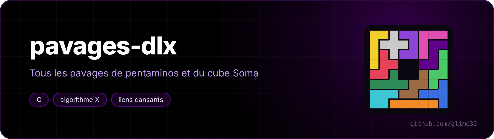
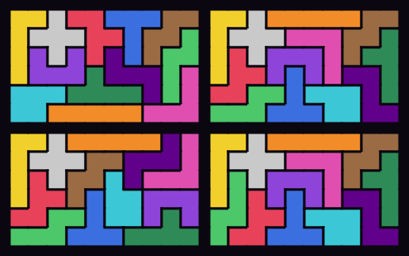
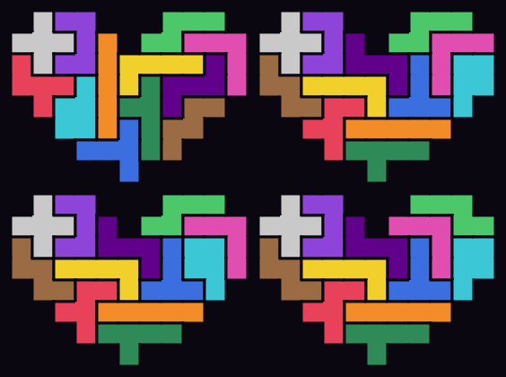

<p align="center"></p>

<p align="center"> </p>

Un solveur de puzzles de pavage en C, construit sur l'**algorithme X** de Donald Knuth et ses **liens dansants** (*Dancing Links*). Il trouve **toutes** les solutions, puis les regroupe à symétrie près.

<p align="center"><a href="README.md">🇬🇧 English version</a></p>



| Puzzle | Solutions distinctes | En tout | Temps |
|---|---|---|---|
| 12 pentaminos dans un 6×10 | **2339** | 9356 | ~1 s |
| 5×12 | 1010 | 4040 | ~1,5 s |
| 4×15 | 368 | 1472 | ~0,6 s |
| 3×20 | 2 | 8 | 0,06 s |
| carré 8×8 troué au centre | 65 | 520 | 0,2 s |
| cœur ([`formes/coeur.txt`](formes/coeur.txt)) | 55 | 110 | 0,5 s |
| cube Soma 3×3×3 (7 pièces en 3D) | **240** | 11520 | 0,4 s |

Tous ces nombres sont les valeurs connues dans la littérature : c'est le test du programme.



## Utilisation

```sh
make
./pavages 6x10                      # une solution dessinée + le décompte
./pavages 8x8 --afficher 5          # les 5 premières solutions distinctes
./pavages soma --svg soma.svg       # le cube Soma, couche par couche
./pavages formes/coeur.txt          # n'importe quelle forme de 60 cases
./pavages 6x10 --sans-astuce        # sans couper les symétries : 7× plus lent, même résultat
./tests.sh                          # les décomptes ci-dessus, en moins d'une seconde
```

Une forme se dessine dans un fichier texte : `#` pour une case à remplir, `.` ou espace pour un trou.

## Comment ça marche

### Couverture exacte

Un pavage est un problème de **couverture exacte** : on a une matrice de 0 et de 1, et il faut choisir des lignes qui contiennent exactement un 1 dans chaque colonne.

- une colonne par pièce (chaque pièce sert exactement une fois) et une par case (chaque case est couverte exactement une fois) ;
- une ligne par façon de poser une pièce : orientation + position. Pour le 6×10 ça fait 2056 lignes (2032 avec l'astuce ci-dessous) et 72 colonnes.

### Algorithme X

Récursif et tout bête : prendre la colonne qui a **le moins** de 1 (la case la plus difficile à couvrir), essayer chacune des lignes qui la couvrent, supprimer toutes les lignes en conflit, recommencer. Si une colonne n'a plus aucun 1, on revient en arrière.

### Liens dansants

La matrice est creuse, donc on ne stocke que les 1, chacun relié à ses voisins gauche/droite/haut/bas dans des listes doublement chaînées circulaires. Retirer un élément :

```c
N[N[x].d].g = N[x].g;
N[N[x].g].d = N[x].d;
```

L'idée de Knuth : **on ne touche pas aux pointeurs de `x`**. Pour le remettre en revenant en arrière, il suffit de

```c
N[N[x].d].g = x;
N[N[x].g].d = x;
```

Les liens « dansent » : des millions de retraits et de remises par seconde, sans aucune allocation. Le programme affiche le nombre de liens défaits (les *updates* de l'article de Knuth).

### Orientations et symétries, en 3D

Toutes les isométries du cube sont les 48 **matrices de permutation signées** 3×3. Les orientations d'une pièce sont ses images par ces matrices, normalisées (translatées vers l'origine, triées) et dédoublonnées :

- pentaminos : les 8 matrices qui laissent l'axe z fixe (rotations et retournements dans le plan) → 63 orientations pour les 12 pièces ;
- Soma : les 24 matrices de déterminant +1 (on ne peut pas retourner une pièce 3D comme dans un miroir) → 92 orientations.

### Compter à symétrie près

Deux idées :

1. **Couper les symétries à la source.** Le pentamino X est symétrique dans tous les sens : on ne garde que ses placements « minimaux » parmi leurs images par les symétries du plateau. Chaque famille de solutions garde au moins un représentant, et la recherche est ~7 fois plus courte.
2. **Forme canonique.** Chaque solution trouvée est transformée par toutes les symétries du plateau, on garde la plus petite version (ordre alphabétique) et on la range dans une table de hachage. La taille de l'orbite donne aussi le nombre total de solutions.

Pour le cube Soma, un miroir transforme une solution en une autre **à condition d'échanger les pièces A et B**, qui sont images l'une de l'autre dans un miroir : c'est géré, et on retombe sur les 240 solutions de la littérature.
