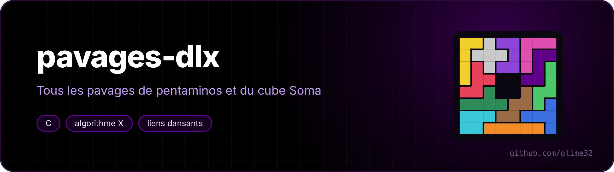
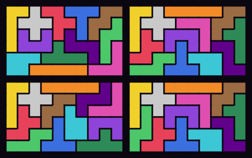
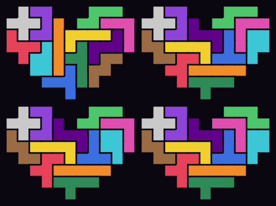

<p align="center"></p>

<p align="center"> </p>

A tiling puzzle solver in C, built on Donald Knuth's **Algorithm X** and his **Dancing Links**. It finds **all** the solutions, then groups them up to symmetry.

<p align="center"><a href="README.fr.md">🇫🇷 Version française</a></p>



| Puzzle | Distinct solutions | Total | Time |
|---|---|---|---|
| 12 pentominoes in a 6×10 | **2339** | 9356 | ~1 s |
| 5×12 | 1010 | 4040 | ~1.5 s |
| 4×15 | 368 | 1472 | ~0.6 s |
| 3×20 | 2 | 8 | 0.06 s |
| 8×8 square with a hole in the middle | 65 | 520 | 0.2 s |
| heart ([`formes/coeur.txt`](formes/coeur.txt)) | 55 | 110 | 0.5 s |
| 3×3×3 Soma cube (7 pieces in 3D) | **240** | 11520 | 0.4 s |

All these numbers are the known values from the literature: they are the program's test.



## Usage

Option names are French: `--afficher` = show, `--sans-astuce` = without the trick.

```sh
make
./pavages 6x10                      # one solution drawn + the count
./pavages 8x8 --afficher 5          # the first 5 distinct solutions
./pavages soma --svg soma.svg       # the Soma cube, layer by layer
./pavages formes/coeur.txt          # any shape of 60 cells
./pavages 6x10 --sans-astuce        # without cutting symmetries: 7× slower, same result
./tests.sh                          # the counts above, in under a second
```

A shape is drawn in a text file: `#` for a cell to fill, `.` or a space for a hole.

## How it works

### Exact cover

A tiling is an **exact cover** problem: given a matrix of 0s and 1s, pick rows so that every column contains exactly one 1.

- one column per piece (each piece is used exactly once) and one per cell (each cell is covered exactly once);
- one row per way of placing a piece: orientation + position. For the 6×10 that's 2056 rows (2032 with the trick below) and 72 columns.

### Algorithm X

Recursive and dead simple: take the column with the **fewest** 1s (the hardest cell to cover), try each of the rows that cover it, remove all conflicting rows, repeat. If a column has no 1 left, backtrack.

### Dancing links

The matrix is sparse, so only the 1s are stored, each one linked to its left/right/up/down neighbours in circular doubly linked lists. Removing an element:

```c
N[N[x].d].g = N[x].g;
N[N[x].g].d = N[x].d;
```

Knuth's idea: **`x`'s own pointers are left untouched**. To put it back when backtracking, all it takes is

```c
N[N[x].d].g = x;
N[N[x].g].d = x;
```

The links "dance": millions of removals and restorations per second, with no allocation at all. The program prints the number of links undone (the *updates* in Knuth's paper).

### Orientations and symmetries, in 3D

All the isometries of the cube are the 48 3×3 **signed permutation matrices**. A piece's orientations are its images under these matrices, normalised (moved to the origin, sorted) and deduplicated:

- pentominoes: the 8 matrices that keep the z axis fixed (rotations and flips in the plane) → 63 orientations for the 12 pieces;
- Soma: the 24 matrices with determinant +1 (you can't mirror a 3D piece) → 92 orientations.

### Counting up to symmetry

Two ideas:

1. **Cut symmetries at the source.** The X pentomino is symmetric in every direction: only its "minimal" placements among their images under the board's symmetries are kept. Every family of solutions keeps at least one representative, and the search is ~7 times shorter.
2. **Canonical form.** Each solution found is transformed by all the board's symmetries, the smallest version (alphabetical order) is kept and stored in a hash table. The size of the orbit also gives the total number of solutions.

For the Soma cube, a mirror turns one solution into another **provided pieces A and B are swapped**, since they are mirror images of each other: that is handled, and the count comes back to the 240 solutions from the literature.
